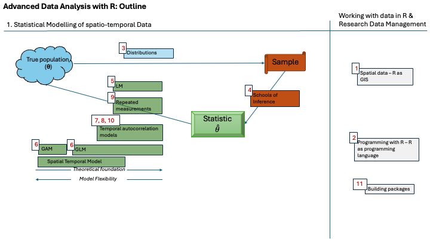
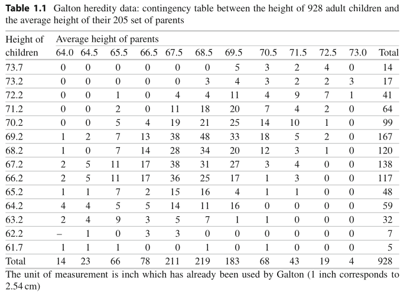

# Preface {.unnumbered}

https://kaihusmann.github.io/stat-data-analysis-r-extra-material-2026/


These accompanying course materials guide you through the entire lectures of Kai, which consist of three lectures of 60 minutes each. This website contains all the information and materials you need to participate interactively and to repeat the material after. This course builds on the content covered in Katrin’s lecture. However, it is not directly relevant to the examination.

::: {.callout-tip}
## Our guiding question
What can observations from a random sample tell us about an unknown population? We will see how the population is connected with the random sample and reveal the role of distributions in this connection. We will do this all on the example of the arithmetic mean.
:::


## Finding your way around

::: {.callout-caution}
## Important milestones,
such as exercises or other interactive activities, are marked with a yellow traffic cone.
:::

::: {.callout-tip}
## Tips and references,
for example to other materials, courses or literature, are marked with a green light bulb.
:::

::: {.callout-warning collapse="true"}
## The red exclamation mark means stop. Tap or click to reveal the content,
so that you can think about it before reading ahead.
:::

Code examples in the statistical programming language R have a grey background.

```{r}
1 + 1
```


## Learning objectives and teaching context

These optional sessions deepen the statistical foundations of the methods explained the lectures (held by Katrin). They are intended for students who would like to understand the reasoning behind those methods and may be interested in working in this field. Participation is not mandatory. As noted above, this supplementary material is not directly relevant to the examination.

Across the three units, you will distinguish population parameters from sample estimates, explain the uncertainty of a sample mean, derive the normal mean using maximum likelihood, and compare the precision of two estimators. This unit bridges to the follow-up course *Advanced Data Analysis with R (M.FES.121.Mp)* in the summer term, which develops the path from population models to statistical methods using advances statistical models.

## Organisation and materials

The course consists of three sessions of 60 minutes each. The sessions accompany the discussion of the R scripts. Any scheduling changes will be announced via StudIP. Please get in touch if you are interested in additional topics.

The HTML book brings together the explanations, figures, executable R examples and quizzes. Quiz feedback is displayed locally in your browser; answers are not submitted anywhere. 

| Unit | Topic |
| --- | --- | --- |
| 1 (12.11.) | Population and sample |
| 2 (3.12.) | Uncertainty and estimation | 
| 3 (21.1.) | Maximum likelihood and efficiency | 


## Further study

The follow-up course *Advanced Data Analysis with R (M.FES.121.Mp)* in the summer term develops the path from population models to statistical methods. It covers advanced models in forestry and ecology, as well as programming, code organisation and collaboration.

{fig-alt="Overview of the Advanced Data Analysis with R course." width=85%}

This document bases in part on materials by Joachim Saborowski, Thomas Kneib and Heike Bickeböller. Further reading includes Fieberg, Vitense and Johnson (2020), *Resampling-based methods for biologists*, and the papers by Bland (1994) and Altman and Bland (1999).

## Motivation example: World's first regression

**Regression toward the mean**

- An example taken from Fahrmeir, Kneib, Lang, Marx (2013): Regression - Models, Methods and Applications (and many other textbooks).
- Sir Francis Galton (1822 - 1911) was a diverse researcher.
- He gathered data illustrating body height of parents and their adult children.
- His hypothesis was that parents pass on their height characteristics to their children (individual effect) but that there is also a population effect (regression towards the mean).
- He built the following contingency table:

### Regression towards the mean



### Regression towards the mean

With this table, he was able to discover the following:

- Column-wise, i.e., for given average heights of the parents, the heights of the
adolescents approximately follow a **normal distribution**.
- The normal distributions in each column have a **common variance**.
- When examining the relationship between the height of the children and the
average height of the parents, an approximate linear trend was found with a slope
of 2/3. 
- A **slope with value < 1** led Galton to the conclusion that children of unusually tall parents tend to be less extreme on average
- In either case there is a tendency towards the **population average**. Galton
referred to this as **regression (**Latin **going back**) **towards the [population] mean**.

### Regression towards the mean

This is how we would visualize the data nowadays:

```{r, message=FALSE, echo=FALSE, fig.width=10, fig.height=6}
library(HistData)
library(ggplot2)
library(tidyverse)
data(GaltonFamilies)
GaltonFamilies %>% ggplot(aes(x = midparentHeight, y = childHeight)) + 
  geom_point() + geom_smooth(method = "lm") + theme_bw()
```

### Regression towards the mean

He extracted from his data that,

- some latent truth exists in a population, and that
- the adjusted child heights conditional on parental height approximate the (already known) normal distribution.

We nowadays interpret his findings such that,

- statistical inference models are able to analyse a **relationship** of some variable *x* “here average size of the parents” on the response variable *y* “here height of adult children”,
- statistical inference models can **filter the latent truth** out of the observed data and noise, and that
- the population follows a certain distribution (**the distribution of the random variable**), which then leads to a observable random-sample distribution (here the same, but we will also discover more complex cases), and that
- Galton invented the linear regression (without noticing).


