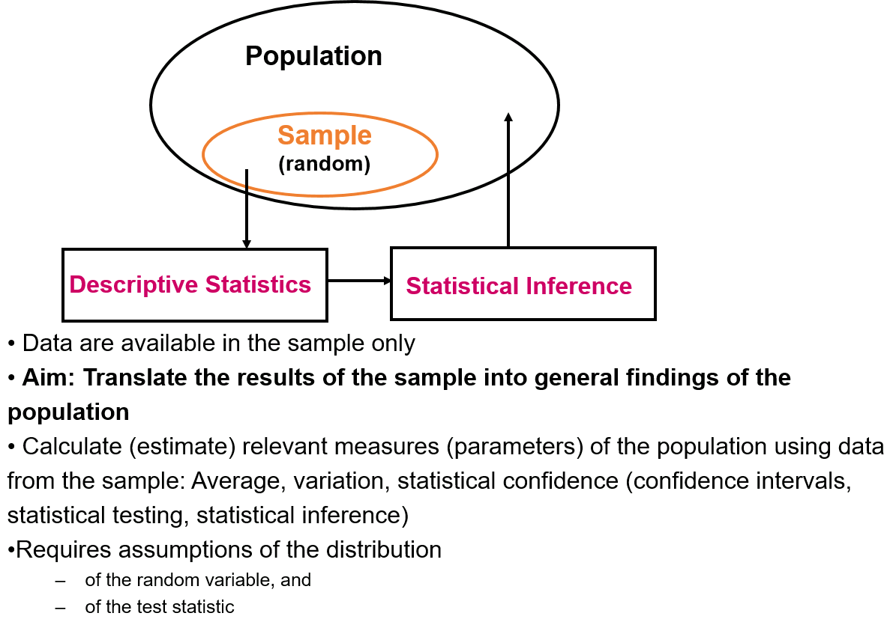

# Population and sample

## Motivation

Suppose we want to know the average diameter of trees in a forest, but we can only measure a small sample. Calculating the average of those measurements is easy. The statistical question is harder: what does that number tell us about the forest?

We will use this example throughout the course. First we distinguish the population we want to understand from the sample we observe. Then we investigate how estimates vary and why particular estimation methods work.

::: {.callout-tip}
### Learning objective
By the end of this unit, you can distinguish a population parameter from a sample estimate, interpret a normal distribution, and use R to draw a sample and calculate its mean and standard deviation.
:::

## Content

### Three levels of statistical reasoning

{fig-alt="Diagram connecting a population, a sample and statistical inference." width=75%}

Our reasoning involves three different distributions:

| Level | Question | Example |
| --- | --- | --- |
| Population distribution | How do individual values vary in the population? | Tree diameters in the forest |
| Observed sample distribution | Which values did we actually measure? | Diameters of ten sampled trees |
| Sampling distribution of an estimator | How would our estimate vary over repeated samples? | Means calculated from many samples of ten trees |

The third level is the focus of the next unit. For now, remember that a histogram of tree diameters and a histogram of sample means describe different things.

### A distribution as a model of the population

A random variable represents an outcome before it is observed. Let $X$ represent the diameter at breast height of a randomly selected tree, measured in centimetres. For our teaching example, we assume

$$
X \sim N(\mu,\sigma^2), \qquad \mu=30, \quad \sigma=2.
$$

The normal distribution has two parameters: the expectation $\mu$, which describes its centre, and the standard deviation $\sigma$, which describes its spread. Its variance is $\sigma^2=4$ square centimetres. This is a deliberately simple model; real tree diameters need not follow a normal distribution.

```{r}
mu <- 30
sigma <- 2
curve(dnorm(x, mean = mu, sd = sigma), from = 22, to = 38,
      xlab = "Diameter (cm)", ylab = "Probability density", lwd = 2)
abline(v = mu, col = "steelblue", lty = 2)
```

The height of this curve is a **density**, not the probability of observing exactly that diameter. For a continuous distribution, probabilities correspond to areas under the curve over intervals. The cumulative distribution function $F(x)=P(X\leq x)$ gives the area to the left of $x$.

### Four distribution functions in R

R uses a consistent naming scheme. The suffix identifies the distribution; the prefix identifies the operation.

| Prefix | Meaning | Normal-distribution example |
| --- | --- | --- |
| `d` | Density | `dnorm()` |
| `p` | Cumulative probability | `pnorm()` |
| `q` | Quantile for a given cumulative probability | `qnorm()` |
| `r` | Random draws | `rnorm()` |

```{r}
# Probability of a diameter between 28 and 32 cm
pnorm(32, mean = mu, sd = sigma) - pnorm(28, mean = mu, sd = sigma)

# Diameter below which 95% of the modelled population lies
qnorm(0.95, mean = mu, sd = sigma)
```

The first result is about 0.68. The second is a diameter in centimetres, not a probability. Notice how `pnorm()` and `qnorm()` answer inverse questions.

### Drawing a sample

Instead of constructing an artificial population tree by tree, we draw observations directly from the population model. Each draw in this example is independent and comes from the same distribution.

```{r}
set.seed(1)
n <- 10
diameters <- rnorm(n, mean = mu, sd = sigma)
round(diameters, 2)
```

`set.seed()` makes the random example reproducible. Here the sampling mechanism is specified by our simulation that is intended to represent a random sample taken in the field.

```{r}
hist(diameters, probability = TRUE, breaks = seq(22, 38, by = 1),
     xlim = c(22, 38), main = "A sample of ten trees",
     xlab = "Diameter (cm)")
curve(dnorm(x, mean = mu, sd = sigma), add = TRUE,
      col = "steelblue", lwd = 2)
```

A small sample histogram is irregular even when the data come from a normal distribution. The sample does not have to reproduce the shape of its population exactly.

### Parameters and estimates

In a real study, $\mu$ and $\sigma$ are unknown. We estimate them from our observations $x_1,\ldots,x_n$:

$$
\bar{x}=\frac{1}{n}\sum_{i=1}^{n}x_i,
\qquad
s=\sqrt{\frac{1}{n-1}\sum_{i=1}^{n}(x_i-\bar{x})^2}.
$$

```{r}
sample_mean <- mean(diameters)
sample_sd <- sd(diameters)
data.frame(quantity = c("Mean", "Standard deviation"),
           population = c(mu, sigma),
           sample_estimate = c(sample_mean, sample_sd))
```

The population parameters stay fixed when we draw another sample; the estimates usually change. The denominator $n-1$ makes $s^2$ an unbiased estimator of the population variance under independent, identically distributed sampling with finite variance. This does not make $s$ itself exactly unbiased.

The arithmetic mean can estimate a population expectation without assuming normality. The normal model will become important later when we derive the mean using maximum likelihood.

::: {.callout-caution}
### Explore the sampling step
Change the seed and draw another sample of ten trees. Compare the mean and standard deviation with the population values. Then increase the sample size to 100. Explain which quantities you expect to become more stable and which quantities remain fixed.
:::

We now have a sample estimate of the population mean. The next question is how much that estimate would change if we repeated the study.

## Quiz

<div class="course-quiz" data-answer="1" data-explanation="The population mean stays fixed, while the sample mean varies across samples."><fieldset><legend>1. Which quantity can change when we draw a new sample from the same population?</legend>
<label><input type="radio" name="population-1" value="0">The population mean only</label>
<label><input type="radio" name="population-1" value="1">The sample mean</label>
<label><input type="radio" name="population-1" value="2">Neither quantity</label>
</fieldset><button type="button" data-check>Check answer</button><button type="button" data-reset>Try again</button><p class="quiz-feedback" role="status" aria-live="polite"></p><noscript>Enable JavaScript to check your answer interactively.</noscript></div>

<div class="course-quiz" data-answer="2" data-explanation="pnorm returns cumulative probabilities. dnorm returns a density and qnorm returns a quantile."><fieldset><legend>2. Which R expression gives P(X &le; 32) for the tree-diameter model?</legend>
<label><input type="radio" name="population-2" value="0">dnorm(32, 30, 2)</label>
<label><input type="radio" name="population-2" value="1">qnorm(32, 30, 2)</label>
<label><input type="radio" name="population-2" value="2">pnorm(32, 30, 2)</label>
</fieldset><button type="button" data-check>Check answer</button><button type="button" data-reset>Try again</button><p class="quiz-feedback" role="status" aria-live="polite"></p><noscript>Enable JavaScript to check your answer interactively.</noscript></div>

<div class="course-quiz" data-answer="1" data-explanation="Sampling variation can produce irregular small-sample histograms even under a normal population model."><fieldset><legend>3. Does an irregular histogram of ten observations prove that the population is not normal?</legend>
<label><input type="radio" name="population-3" value="0">Yes, the histogram must follow the curve exactly</label>
<label><input type="radio" name="population-3" value="1">No, small samples can have irregular histograms</label>
<label><input type="radio" name="population-3" value="2">Yes, unless the sample mean equals 30</label>
</fieldset><button type="button" data-check>Check answer</button><button type="button" data-reset>Try again</button><p class="quiz-feedback" role="status" aria-live="polite"></p><noscript>Enable JavaScript to check your answer interactively.</noscript></div>
